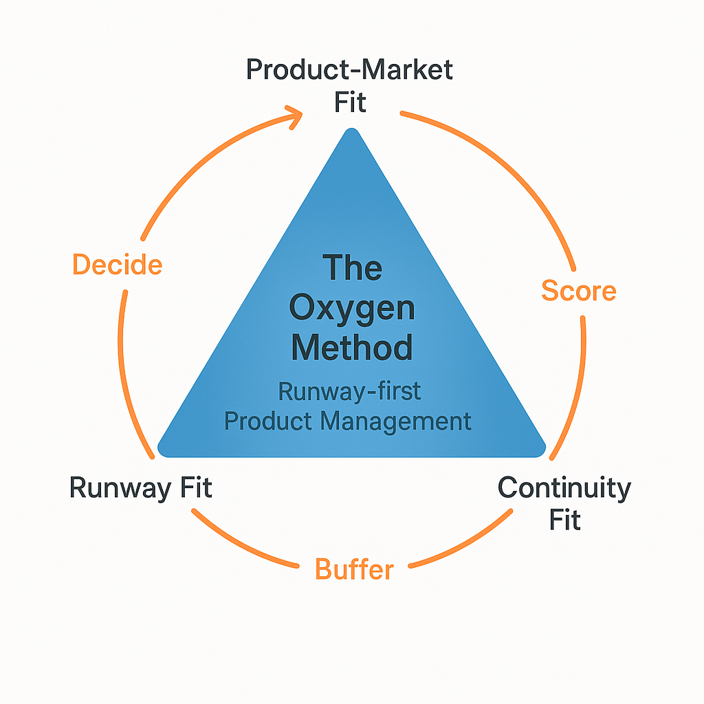
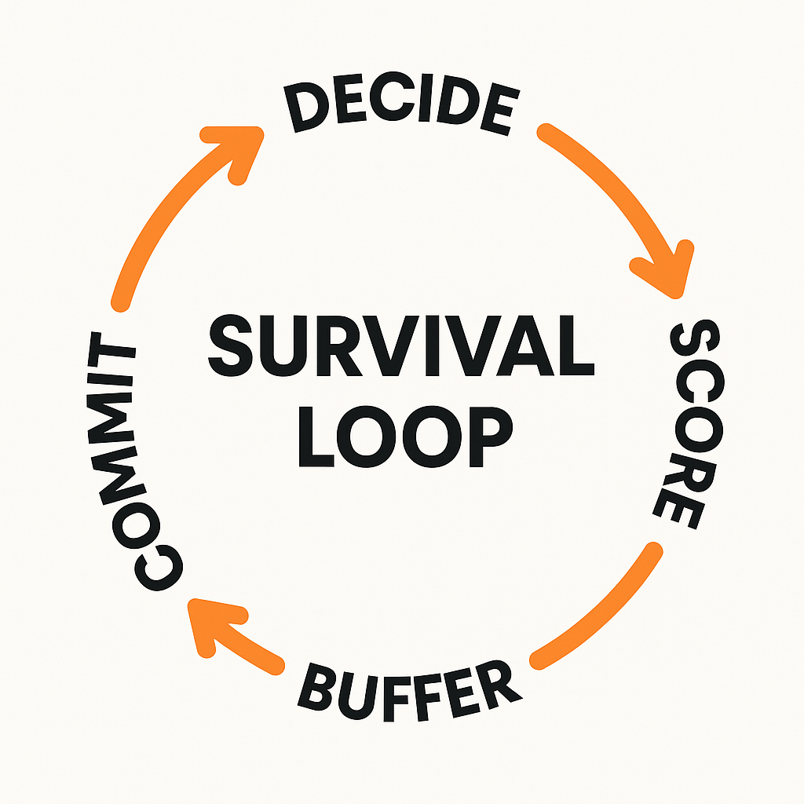
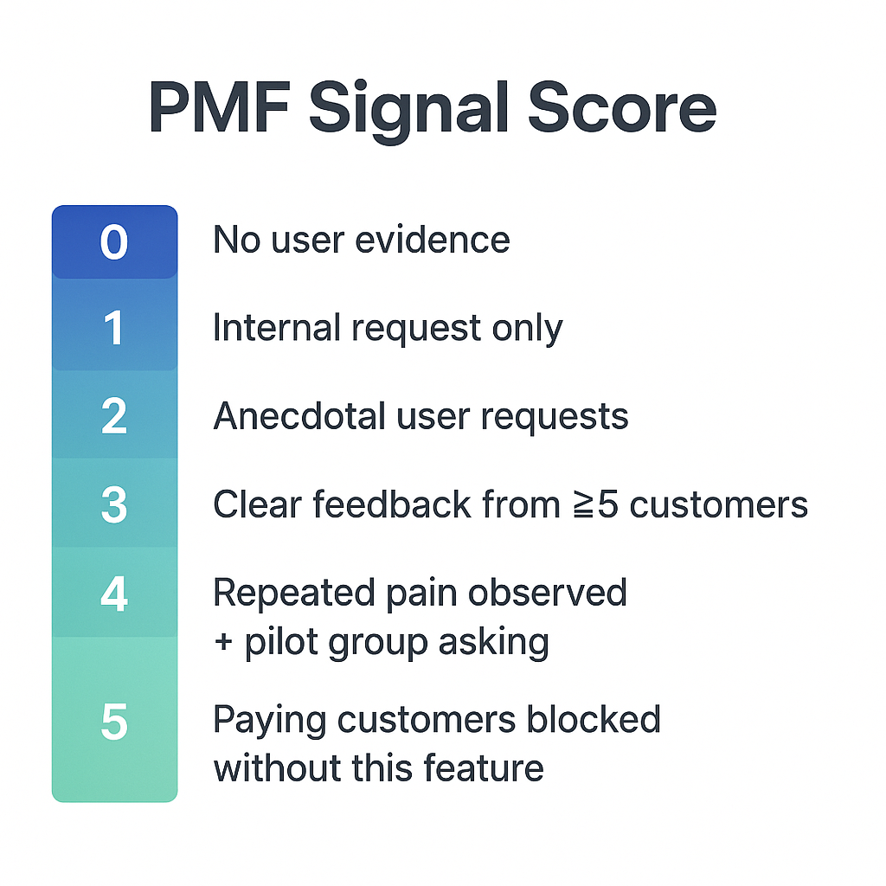
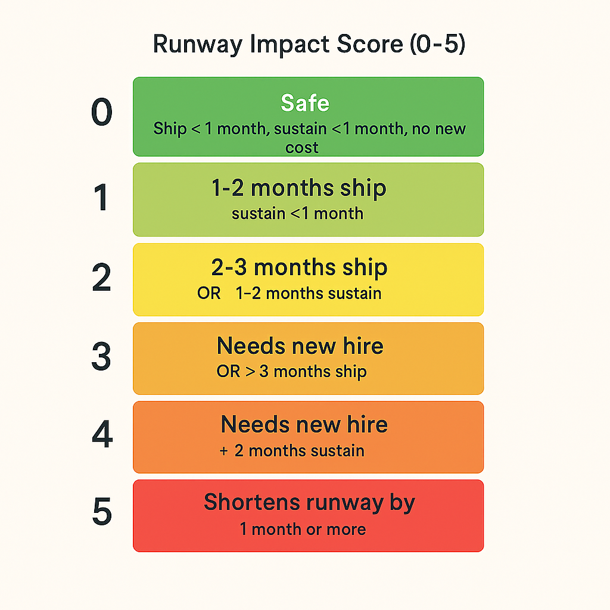
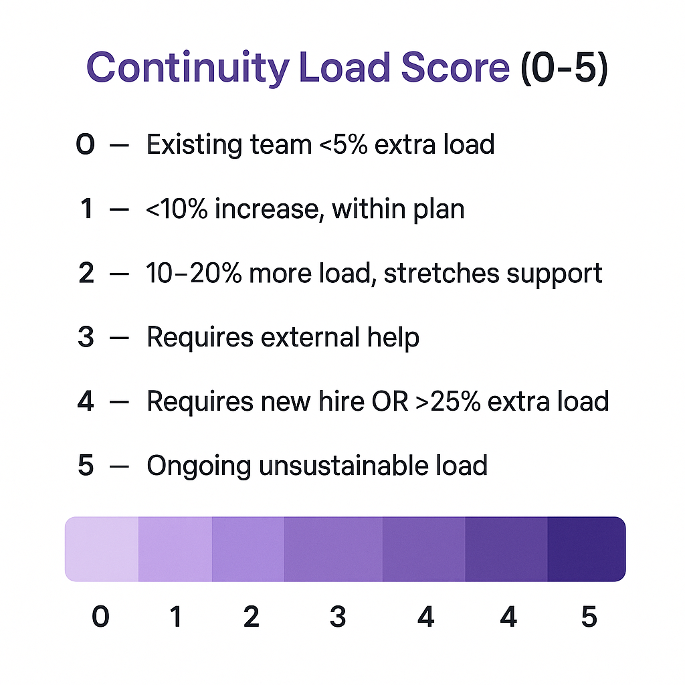
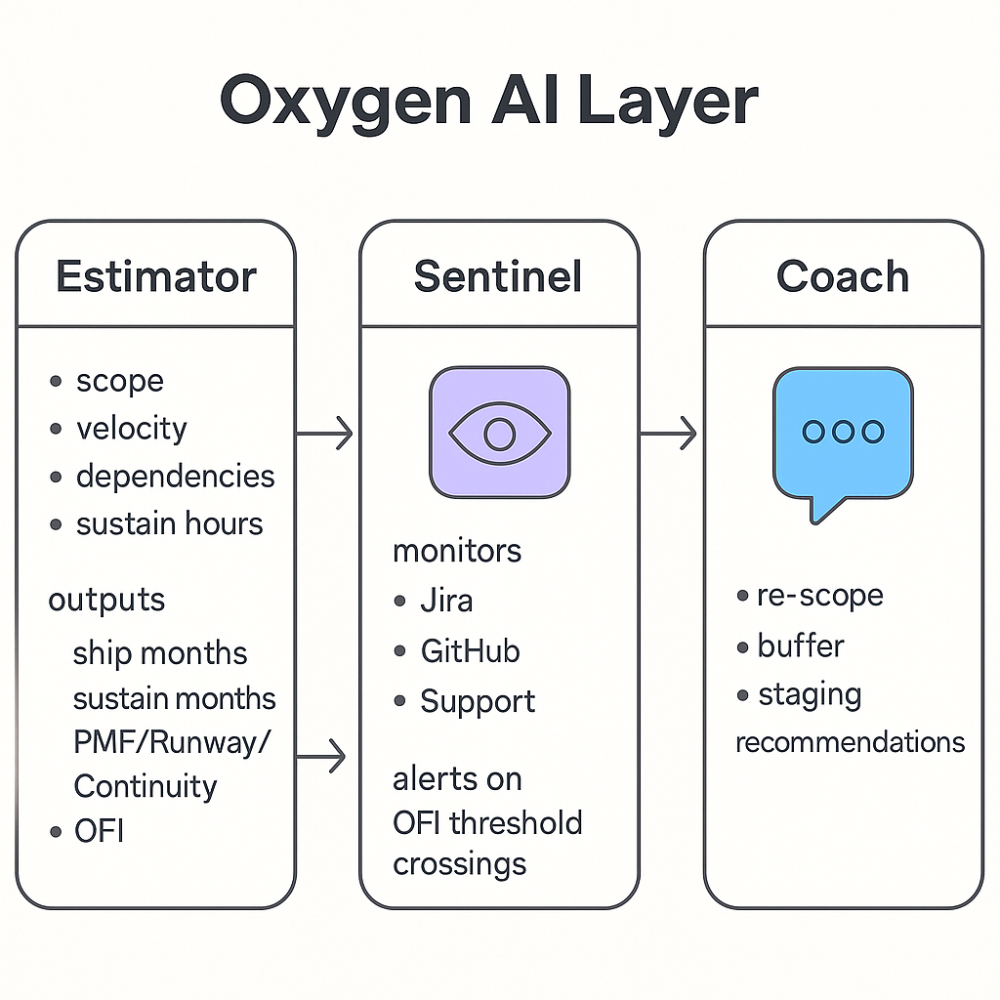

# The Oxygen Method™ (OFI)

**A runway-first decision framework for product and program managers.**

> **OFI = PMF − (Runway + Continuity)**

Decide what to ship now, and make sure you can sustain it after launch. OFI (Oxygen Fit Index) turns "can we build it?" into "can we ship and sustain it?"

Created by Amir Pournajib and Sara Soltaninejad.

📄 **[Download the one-pager (PDF)](oxygen_onepager.pdf)** · 🌐 **[View the web page](https://amirpournajib.github.io/oxygen/)**

  
  

## The three scores (0 to 5 each)

| Score | What it measures |
|---|---|
| **PMF** (Product-Market Fit) | User and customer pull |
| **Runway** | Months to ship and sustain within your oxygen |
| **Continuity** | Team and operations capacity to run it |

## How to use it (a 10-minute gate)

1. Score PMF, Runway and Continuity from 0 to 5 with the rubric.
2. Compute OFI:

| OFI | Decision |
|---|---|
| Above 0 | Survivable: commit |
| Equal to 0 | Needs buffer: add buffer for support, hiring and go-to-market |
| Below 0 | Rescope, stage or delay |

3. Record the months to ship and sustain plus your assumptions, and recheck every sprint.

  
  
  

## AI assist (optional)

- **Estimator:** computes ship and sustain months, maps them to scores, returns the OFI with a rationale.
- **Sentinel:** watches for drift in scope, velocity and tickets, and flags when the OFI crosses a threshold.
- **Coach:** suggests staging, buffers and thin slices to reach an OFI of 0 or more.

## What's in this repo

| File | What it is |
|---|---|
| `oxygen_onepager.pdf` | The one-page summary |
| `*.png` | Figures used in the one-pager |
| `index.html` | Static page for GitHub Pages |

## License and trademarks

- Code: [MIT](LICENSE)
- Text and figures: © 2025 Amir Pournajib and Sara Soltaninejad, [CC BY-ND 4.0](LICENSE-docs.md)
- Oxygen Method™ and Oxygen Fit Index™ (OFI) are trademarks of Amir Pournajib. See [TRADEMARKS.md](TRADEMARKS.md).

You are welcome to reference and teach the method with attribution: "based on the Oxygen Method (Pournajib)".
